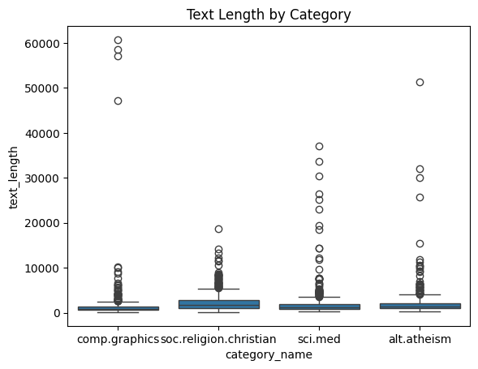
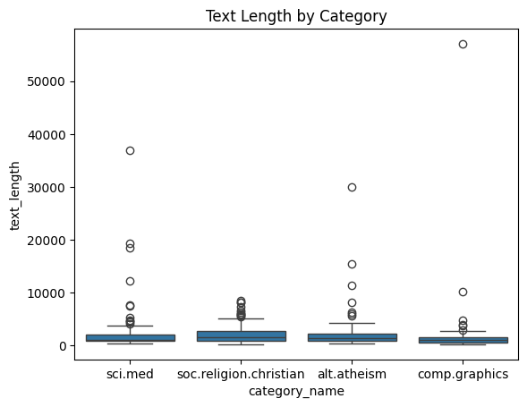
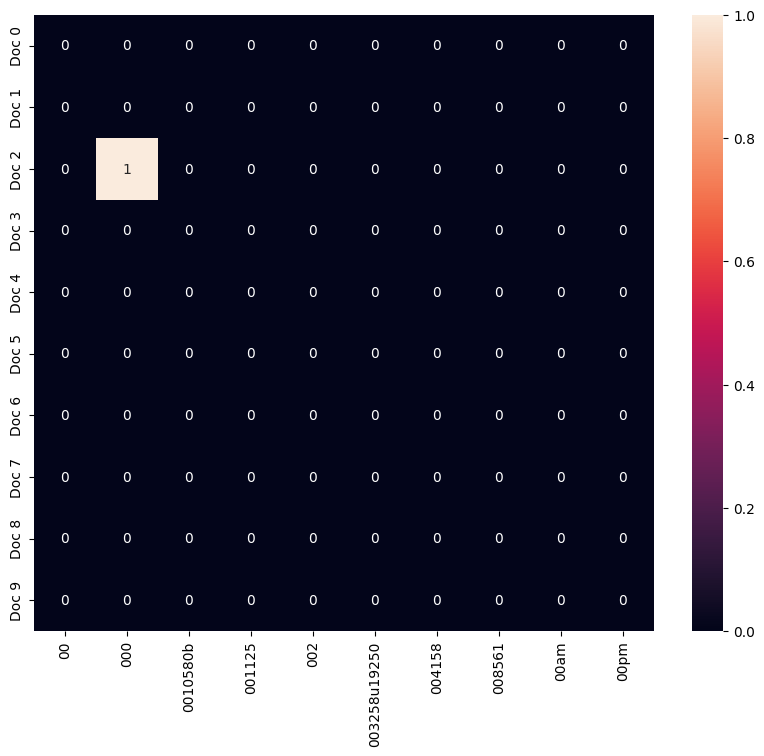
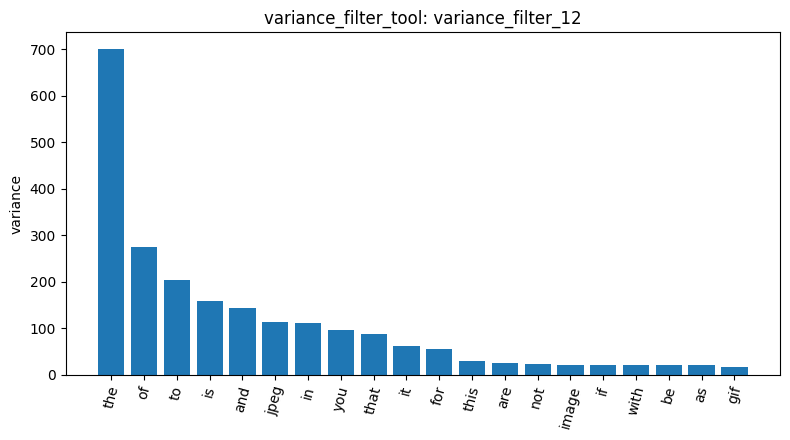
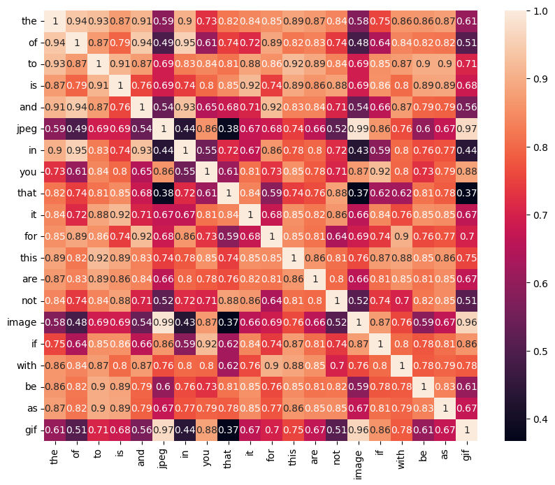
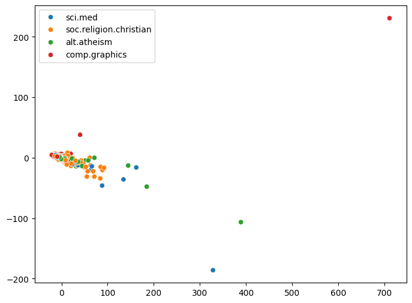
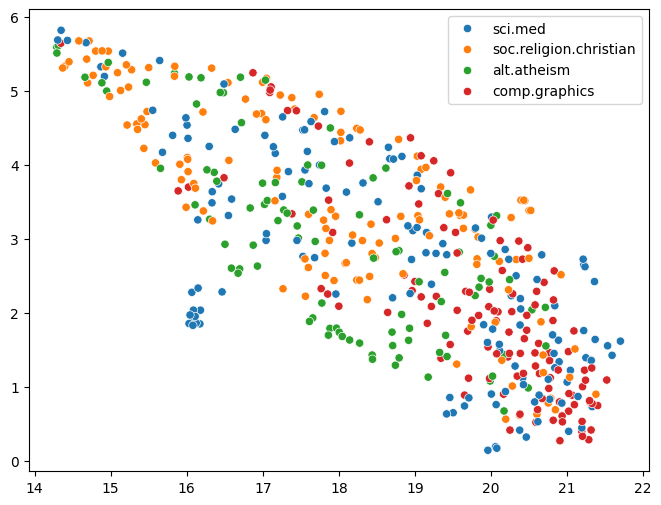

# Agentic Pipeline report

Firstly, I wanted to mention that I used Gemini-3.1-flash-lite model and used a paid API Key as I kept on having 503 errors or rate-limits issues.

The 20 Newsgroups dataset (load_dataset_1) initially contained 2,257 documents across four categories: soc.religion.christian (599), sci.med (594), comp.graphics (584), and alt.atheism (480). No missing or empty texts were found (missing_3), and no duplicates were detected (duplicates_4). Text-length analysis (describe_5) showed a strongly right-skewed distribution, with a mean of approximately 1,993 characters and a median of 1,235. The longest document contained 60,713 characters (from comp.graphics). A random sample of 500 documents was selected for computational efficiency (sample_6, random_state=42). Its class proportions were relatively close to those of the original dataset, although sci.med was slightly overrepresented and alt.atheism underrepresented. The sample did not contain the 60,713-character document, but it did include another unusually long comp.graphics document of 57,076 characters (describe_7).

*Figure 1. Distribution of document lengths by category in the full dataset (`describe_5`).*

*Figure 2. Distribution of document lengths by category in the 500-document sample (`describe_7`).*

The document-term matrix (dtm_8) contained 500 documents and 16,283 terms, with aproximately 99.0% sparsity. The heatmap (heatmap_10) illustrates this sparsity. Among the first ten documents and the first ten terms, only one cell was non-zero. Several initial vocabulary entries were numbers or identifiers, most likely email headers, signatures, and other irrelevant text. The most frequent terms were common English stopwords, including the, of, to, and, and is, indicating that raw word counts were dominated by words that weren't meaningful. Variance filtering (variance_filter_11 and variance_filter_12) removed low-variance terms, but the highest-variance words still included many stopwords. Terms such as jpeg, image, and gif also had high variance, probably because unusually long technical messages repeated them many times. The correlation matrix (corr_matrix_15) showed correlations of approximately 0.8–0.95 between common stopwords, while jpeg, image, and gif had correlations around 0.96–0.99. These strong associations likely reflect document length and a few long technical posts rather than general thematic relationships.

*Figure 3. Heatmap of the first ten documents and terms in the DTM (`heatmap_10`).*

*Figure 4. Twenty terms with the highest variance after filtering at a threshold of 0.01 (`variance_filter_12`).*

*Figure 5. Correlation matrix for the twenty highest-variance terms (`corr_matrix_15`).*

Pearson and Spearman correlations with the comp.graphics category identified different types of vocabulary (pearson_filter_13 and spearman_filter_14). Pearson correlation ranked keywords (0.303), graphics (0.302), vga (0.275), 3d (0.265), and mode (0.255) among the top five terms. Although these results included relevant technical vocabulary, keywords probably originated from the email header field `Keywords:`. Spearman correlation ranked graphics first (0.560), followed by 3d (0.393), that (-0.363), files (0.348), and ftp (0.347). The stronger correlation for graphics suggests that rank-based analysis was less affected by extreme word counts in long documents. The negative correlation for that indicates that this word was less associated with comp.graphics than with the other categories. FP-Growth initially generated too many patterns, exceeding the context limit (loaded 1 000 000 tokens). In a second session, switching to the top-k algorithm with k = 20 (patterns_4) avoided this problem, but the results were dominated by email-header terms such as lines, subject, organization, edu, and university. The support of 119 for some patterns corresponded to all sampled comp.graphics documents. Removing English stopwords did not eliminate these header fields, so the extracted patterns reflected message structure rather than meaningful topics.

PCA (dim_red_pca_5, session 2) explained approximately 70.04% of the variance along the first component and 7.92% along the second, although these figures were not independently verified. Its projection showed most documents clustered near the origin, with one distant comp.graphics point, likely corresponding to the 57,076-character document. The first component therefore appears to capture document length and raw word-count variation more strongly than topic. UMAP (dim_red_umap_6, session 2) distributed the documents more evenly and revealed some grouping, particularly for comp.graphics, while alt.atheism and soc.religion.christian remained largely mixed and sci.med was dispersed. Cosine similarity provided complementary but limited evidence: two sci.med documents scored 0.361, compared with 0.268 for a sci.med and a comp.graphics document. Two alt.atheism documents by the same author scored 0.416. These examples are consistent with greater lexical overlap between documents sharing a category or author, but only three pairs were tested, so no general conclusion can be drawn. Cosine similarity is insensitive to document magnitude, but common vocabulary and shared headers can still inflate similarity scores.

*Figure 6. PCA projection of the 500 documents, coloured by category (`dim_red_pca_5`, session 2).*

*Figure 7. UMAP projection of the 500 documents, coloured by category (`dim_red_umap_6`, session 2).*

Overall, the results show that raw word counts are strongly influenced by document length, stopwords, and email headers, limiting their usefulness for identifying meaningful topics. The pipeline also presented practical limitations: term frequencies were returned without sorting, variance-filtering counts were not directly provided, and unrestricted pattern extraction caused a context-limit failure. Several numerical summaries produced by the agent could not be independently verified and should therefore be treated cautiously. Improvements would include removing email headers and stopwords before constructing the DTM, applying TF-IDF or L2 normalization, using stratified sampling to preserve class proportions, and limiting pattern extraction outputs. These changes could reduce structural noise and length-related effects, making correlations, visualizations, and extracted patterns more representative of document content.