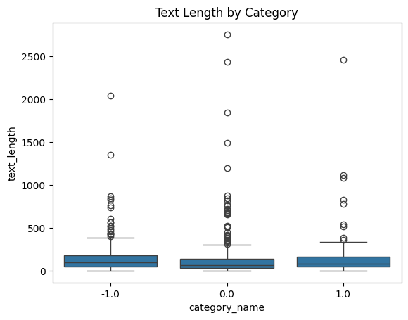
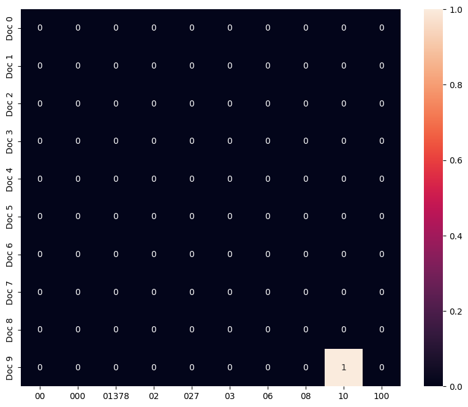
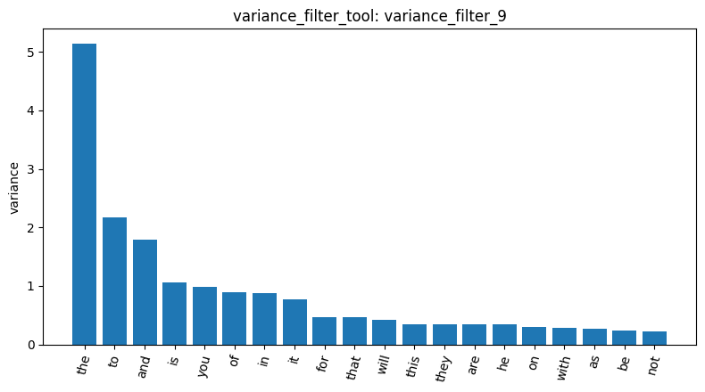
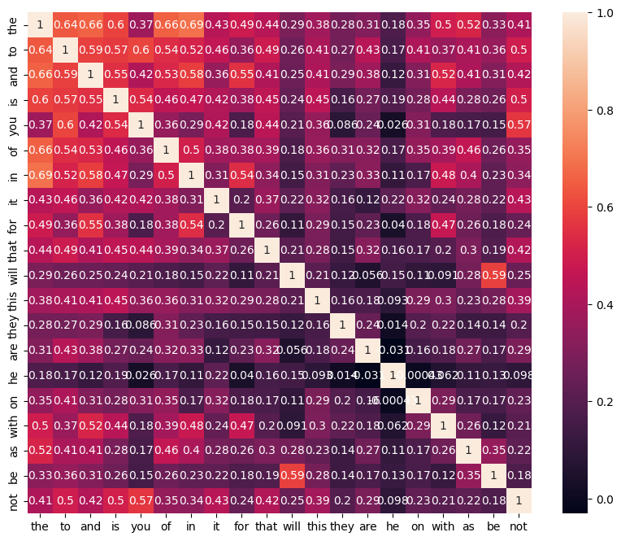
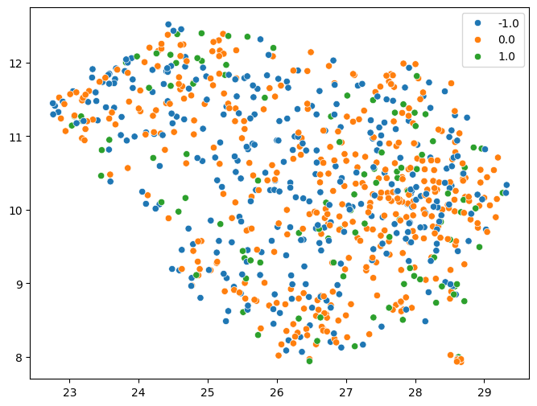

# Reddit Stock Sentiment Homework Report

The Reddit stock-sentiment dataset (load_dataset_1) initially contained 847 posts and comments, labelled as negative (315), neutral (423), or positive (109). Positive messages represented only 12.9% of the dataset. No missing or empty texts were found (missing_3), but duplicate removal (duplicates_5) reduced the dataset to 813 documents, mainly by removing repeated automated posts. Text-length analysis (describe_6) showed a right-skewed distribution, with a median below 100 characters. Negative messages were generally longer (median 96 characters) than neutral messages (68 characters). In comparison, the 20 Newsgroups sample had a median document length of 1,235 characters (describe_5, AgenticPipeline log).

*Figure 1. Distribution of text lengths by sentiment class (`describe_6`).*

The word-level document-term matrix (dtm_7) contained 813 documents and 4,313 terms, with approximately 99.52% sparsity. The Newsgroups matrix was slightly less sparse, at around 99.0% (dtm_8, AgenticPipeline log). The heatmap (heatmap_8) shows how few terms occur in the first ten documents. Variance filtering (variance_filter_9) was used to select terms with more variable counts, although the highest-variance words were mostly common English words. In Newsgroups, terms such as jpeg, image, and gif also had high variance (variance_filter_12, plot turn116, AgenticPipeline log), possibly because of unusually long technical documents.

*Figure 2. Heatmap of the first documents and terms in the DTM (`heatmap_8`).*

*Figure 3. Twenty terms with the highest variance (`variance_filter_9`).*

Pearson and Spearman correlations with negative sentiment (pearson_filter_10, spearman_filter_11) identified words such as he, his, will, trump, and fuck. This suggests that negative sentiment may partly reflect political discussions, including Trump and the trade-tariff period, although the correlations remained weak: the maximum values were 0.176 for Pearson and 0.196 for Spearman. On Reddit, both methods returned almost the same five leading words. Because the messages are short, most words occur either zero or once, so their frequency values and ranks tend to be similar. In Newsgroups, the rankings diverged more: for comp.graphics, Pearson correlation for graphics was 0.302, while Spearman correlation reached 0.560 (pearson_filter_13 and spearman_filter_14, AgenticPipeline log). The correlation matrix (corr_matrix_12) also showed correlations of roughly 0.4–0.69 between common words, including approximately 0.69 for the and in. In Newsgroups, correlations between stopwords were higher, around 0.8–0.95 (corr_matrix_15, AgenticPipeline log), consistent with document length having a stronger influence on word counts in the longer texts.

*Figure 4. Correlation matrix for the twenty highest-variance terms (`corr_matrix_12`).*

The bigram matrix (dtm_13) was even sparser, at approximately 99.85%. Correlation analysis (pearson_filter_14) highlighted expressions such as trump is, trade war, and the economy. FP-Growth (patterns_15) identified combinations including (trade, war, china) and (tariffs, china), suggesting that some negative messages concerned trade tensions and economic uncertainty. These patterns were rare, so they should be treated as exploratory rather than representative of all negative messages. In contrast, the top patterns from the second Newsgroups session (patterns_4, AgenticPipeline log) were dominated by email-header terms such as subject, lines, and organization. Reddit patterns were more thematically interpretable, while Newsgroups patterns mainly reflected message structure.
UMAP (dim_red_umap_17) projected the Reddit documents into two dimensions, but the negative, neutral, and positive classes were heavily mixed, with no clear separation (they overlap a lot). Newsgroups UMAP showed some grouping by topic, especially for comp.graphics (dim_red_umap_6, AgenticPipeline log), although the categories still overlapped. Cosine similarity also showed the limits of raw word counts: Reddit doc 4 and doc 6, both negative, had a similarity of 0.0, whereas Reddit doc 6 and doc 9, with different sentiment labels, had a similarity of 0.336. In Newsgroups, the tested same-category pair scored 0.361, compared with 0.268 for a different-category pair (AgenticPipeline log). These examples suggest that lexical overlap does not necessarily correspond to shared sentiment.

*Figure 5. UMAP projection of Reddit documents coloured by sentiment (`dim_red_umap_17`).*

Overall, the results suggest that raw word counts capture topical vocabulary more clearly than sentiment distinctions when messages with different polarities discuss the same subjects. Both datasets contain sparse matrices and frequent words, and the available DTM construction did not remove stopwords or apply TF-IDF or L2 normalization. Reddit also presents short messages, class imbalance, and potentially noisy sentiment labels, whereas Newsgroups is affected by email headers and unusually long documents. Cleaning irrelevant tokens and headers, normalizing document vectors, and testing text embeddings could improve the analysis.
